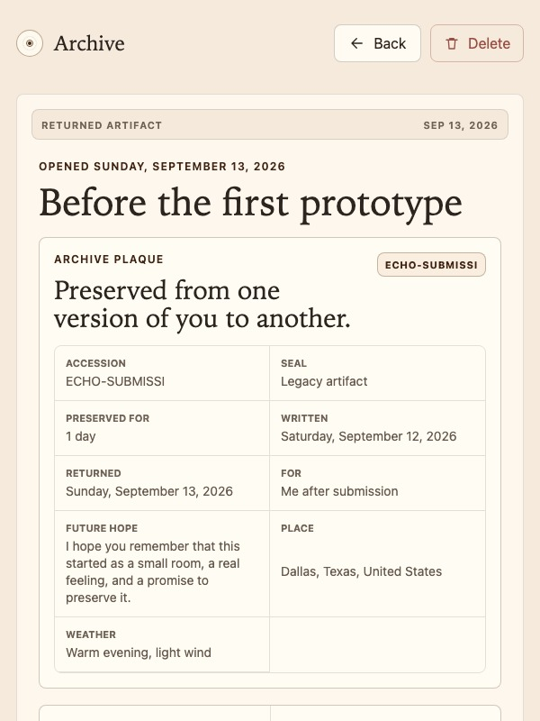
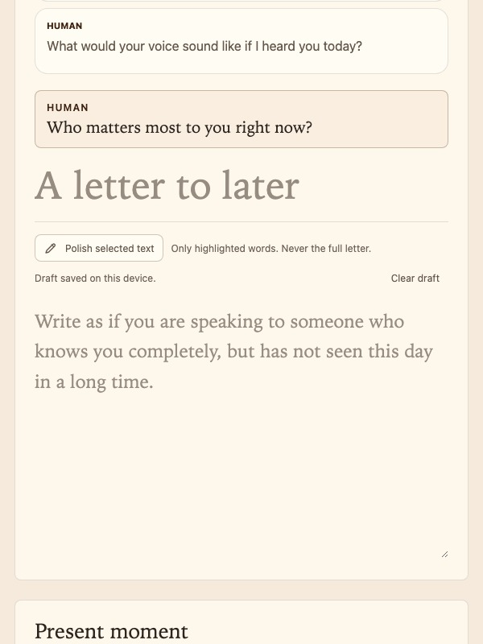
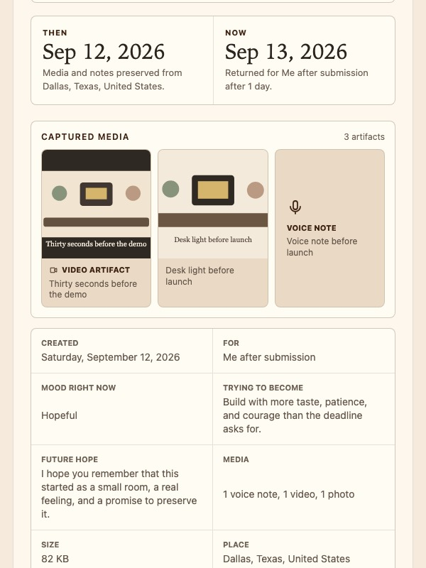
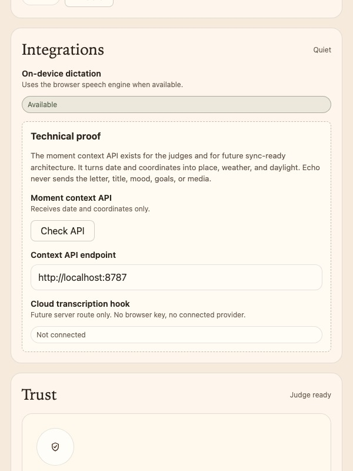

<div align="center">
  

  <h1>Echo</h1>

  <p><strong>A private time capsule for preserving a human, a place, and a moment in time.</strong></p>

  <p>
    <a href="#walkthrough">Walkthrough</a> ·
    <a href="#screenshots">Screenshots</a> ·
    <a href="#why-this-exists">Why it exists</a> ·
    <a href="#technical-architecture">Architecture</a> ·
    <a href="#running-locally">Run locally</a>
  </p>

  <p>
    <strong>Local-first</strong> ·
    <strong>Sealed-content privacy</strong> ·
    <strong>Voice and video capture</strong> ·
    <strong>Docker-ready API</strong> ·
    <strong>Playwright tested</strong>
  </p>
</div>

## Walkthrough

<p align="center">
  <a href="docs/assets/submission/echo-demo-walkthrough.webm">
    
  </a>
</p>

<p align="center">
  <a href="docs/assets/submission/echo-demo-walkthrough.webm"><strong>Watch the silent product walkthrough</strong></a>
</p>

Echo lets someone write to a future version of themselves, add voice or video, capture the context around the moment, and seal the Echo until a chosen date. Until that date arrives, Echo hides the title, letter, media, mood, place, weather, and other emotional details from the everyday interface.

## Screenshots

<p align="center">
  
  
  
</p>

<p align="center">
  
  
  
</p>

The CAC cover image is available at `docs/assets/echo-cover-600x800.jpg`. The full upload-ready media set is in `docs/assets/submission/`: ten `600x800` JPEGs plus `echo-demo-walkthrough.webm`.

## Submission Build

The current `main` branch is the working Congressional App Challenge submission build. It is a functional local-first prototype, not a screen-only concept: users can create and seal Echoes, record local media, preserve moment context, export or restore an archive, and open returned Echoes through the real reveal flow.

Verified October 18, 2026:

- 88 Playwright browser-test executions pass across mobile and desktop projects.
- 2 context API tests pass.
- 4 offline Promptfoo policy checks pass.
- The repository contains the Docker setup, PWA shell, submission screenshots, silent walkthrough, and GitHub Actions quality workflow.

The app is intentionally accountless for this version. It has no cloud database, runtime AI model, public social feed, or production deployment. Those are product boundaries, not hidden claims.

## Why This Exists

Most apps preserve files. Echo preserves the situation around a person before that moment disappears.

Someone can save what they sounded like, what room they were in, what they hoped would happen, and what they wanted their future self to remember. A student could seal an Echo before graduation. A founder could record the first prototype. A family member could preserve a specific day before life changes.

The large idea is identity over time. Echo gives ordinary people a way to leave a private artifact for a future self without turning the artifact into public content.

## What The App Does

- Creates sealed Echoes with a letter, future open date, present-moment details, future hopes, mood, and optional media.
- Records voice and video with browser media APIs.
- Supports local dictation when the browser provides speech recognition.
- Captures optional moment context through an API that receives only date and coordinates.
- Shows returned Echoes as archive artifacts after their open date.
- Hides sealed Echo content by default.
- Requires an intentional Archive Key phrase before early opening.
- Exports and imports local JSON backups.
- Exports privacy-safe calendar reminders that do not include sealed titles or letter text.
- Installs as an iPhone-style progressive web app shell.

## Privacy Model

Echo is local-first. Letters, media, mood, goals, and sealed details stay in browser storage unless the user exports a backup.

The context API does not receive private writing. It accepts only:

- `lat`
- `lon`
- `date`

It returns place, weather, and daylight context. The API response includes a privacy contract, and the test suite verifies that letter text is not sent to the API.

The app also avoids casual access to future content. Sealed Echoes can be counted as waiting, but their titles, media names, letter text, mood, goals, and location details stay hidden until the Echo returns or the user deliberately enables the Archive Key.

## Technical Architecture

Echo is a static web app with a small Node context API.

- Frontend: HTML, CSS, and JavaScript in `outputs/echo/`.
- Storage: IndexedDB and local browser storage.
- Media: MediaRecorder, file attachments, and local object/data URLs.
- Dictation: Web Speech API when available.
- Context API: Node HTTP server in `api/server.js`.
- External context sources: Open-Meteo for weather and BigDataCloud for reverse geocoding.
- PWA shell: manifest, icons, and service worker.
- Docker: one static frontend service and one context API service.
- Tests: Playwright browser tests, Node API tests, and Promptfoo policy checks.

This structure keeps the prototype easy to run while still showing real technical decisions around privacy, media capture, browser storage, API boundaries, offline behavior, and regression testing.

## AI Disclosure

AI coding tools assisted development, research, debugging, and review.

Echo itself is not an AI chatbot. The current app includes a small writing-polish prototype that works on explicitly selected text and does not call an AI model. The repository includes Promptfoo checks for future AI features so that any later model integration must preserve consent, privacy, and sealed-content boundaries.

## Running Locally

Prerequisites: Node.js 22 is recommended, matching the GitHub Actions and Docker runtime. Python 3 is used for the static local web server.

Install dependencies:

```sh
npm install
```

Run the frontend:

```sh
npm run serve
```

Open:

```text
http://127.0.0.1:4174
```

Run the context API in another terminal:

```sh
npm run serve:api
```

API health check:

```text
http://127.0.0.1:8787/api/health
```

## Running With Docker

```sh
docker compose up --build
```

Services:

- Frontend: `http://localhost:4174`
- Context API: `http://localhost:8787`

## Quality Checks

Run the full local quality gate:

```sh
npm run quality
```

This runs:

- JavaScript syntax checks.
- Playwright browser tests across mobile and desktop profiles.
- Node API tests for the context service.
- Promptfoo checks for AI feature boundaries.

Current coverage focuses on the product rules that matter most: sealed-content privacy, Archive Key behavior, prompt behavior, media handling, import/export safety, accessibility, route behavior, PWA metadata, and API privacy.

## Demo Path

For a short judge demo:

1. Open the walkthrough screen.
2. Load the demo Echo.
3. Show that sealed Echoes stay hidden.
4. Open Write and show letter writing, voice/video capture, media attachments, moment context, and selected-text polish.
5. Open the Trust or Settings area and explain the local-first privacy model.
6. Open a returned Echo and show the archive reveal.

The strongest way to explain Echo is: it captures a human, a place, and a time before the present becomes unreachable.

## Project Documentation

- [`CONTEXT.md`](CONTEXT.md): domain language and product rules.
- [`docs/adr/0001-local-first-before-cloud-sync.md`](docs/adr/0001-local-first-before-cloud-sync.md): why the submission build does not use Supabase or Convex.
- [`docs/context-api.md`](docs/context-api.md): moment-context API contract and privacy boundary.
- [`docs/ai-usage-disclosure.md`](docs/ai-usage-disclosure.md): development-tool disclosure and current in-app AI boundary.
- [`docs/design-quality-bar.md`](docs/design-quality-bar.md): visual, interaction, and accessibility standards.
- [`docs/demo-script.md`](docs/demo-script.md): final recording structure for the CAC demonstration video.
- [`docs/assets/submission/README.md`](docs/assets/submission/README.md): upload-ready screenshots and walkthrough assets.

## Future Work

Echo should stay local-first until cloud sync is worth the privacy cost. Future work could add encrypted sync, native mobile packaging, stronger reminder scheduling, and a production deployment. Those features should sit behind the existing storage and privacy boundaries instead of replacing them.
